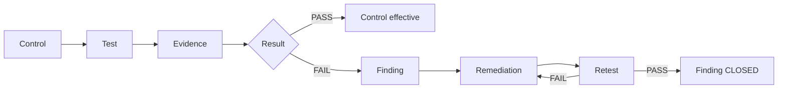

# ControlOps — GRC / IT Controls Proof of Concept

[](https://github.com/<your-user>/controlops-grc/actions)

A proof of concept that models how an IT control becomes an operational process: **testing, evidence, findings, remediation and retest**, inspired by real-world GRC workflows.

> This is an independent portfolio project. It is **not** a clone of, nor affiliated with, any commercial GRC platform. All data is synthetic.

## Workflow



## Features

- **Dashboard** — controls tested / passed / failed / pending, open and overdue findings, charts, recent activity.
- **Controls** — objective, risk, test procedure, owner, evidence, latest result, full test history; register new test results.
- **Findings** — severity, owner, due date, status, filters.
- **Remediation & Retest** — enforced lifecycle `OPEN → IN_REMEDIATION → READY_FOR_RETEST → CLOSED`.
- **Evidence** — file preview, SHA-256 integrity hash, upload.
- **Audit trail** — every status change is recorded in `finding_history`.

## Business rules (enforced in `app/workflow.py`, covered by tests)

| Rule | Reason |
|---|---|
| A control's status is the result of its most recent test; no test = `PENDING` | Single source of truth |
| A `PASS` result requires evidence | No evidence, no assurance |
| A remediation plan is required before moving to `IN_REMEDIATION` | Accountability |
| A finding can only reach `CLOSED` through a **passing retest** | Closes the loop |
| A failing retest returns the finding to `IN_REMEDIATION` | No false closure |
| Closed findings are immutable | Audit integrity |
| Overdue = not `CLOSED` and `due_date` < today | Consistent SLA tracking |

## Quick start

```bash
python -m venv .venv && source .venv/bin/activate   # Windows: .venv\Scripts\activate
pip install -r requirements-dev.txt
pytest -q
streamlit run app/main.py
```

The SQLite database (`data/controlops.db`) is created and seeded automatically on first run. Delete it to reset the demo. Set `CONTROLOPS_DB` to use another path.

## Project structure

```
app/            Streamlit pages (dashboard, controls, findings, remediation, evidence), workflow.py (business rules), db.py
database/       schema.sql, seed.sql (synthetic demo data)
data/           controls.csv, findings.csv (exports), evidence/ (sample files)
tests/          pytest suite for the workflow rules
screenshots/    UI screenshots used in this README
```

## Data model

`controls` 1─n `control_tests` n─1 `evidence` · `control_tests` 1─n `findings` · `findings` 1─n `finding_history`.
`v_control_status` derives each control's current status from its latest test.

## Screenshots

Add after running the app locally: `screenshots/dashboard.png`, `control.png`, `finding.png`.

## Limitations & roadmap

- Single-user, no authentication or role-based access (a production tool would need both).
- SQLite for simplicity; the schema is portable to PostgreSQL.
- Roadmap: PostgreSQL option, RBAC, control-to-framework mapping (e.g., ISO 27001, SOC 2), CSV export of audit reports, automated evidence checks.

## License

MIT
